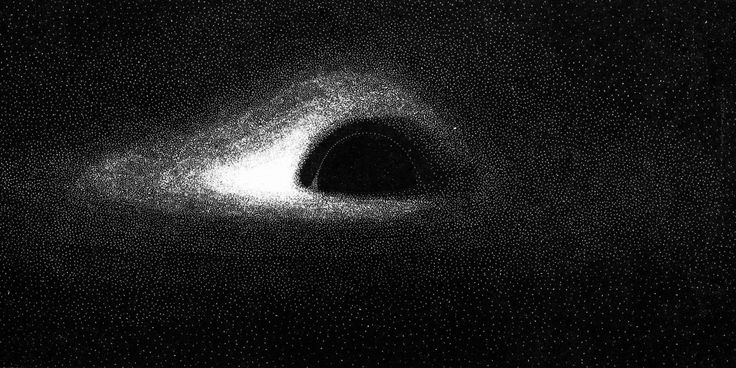

 

# Georgy Antony Pious

**AI & Data Science student · aspiring LLM systems engineer**

## About Me

I'm **Georgy Antony Pious**, a B.Tech student in AI & Data Science (minor in Robotics & Automation) at SJCET, Palai, graduating in 2027. I like turning ideas into things that actually work, and I'm especially drawn to what's happening underneath the surface of AI systems — from how data becomes tokens to how models learn and make decisions.

**Some things I've built:**

- 🧠 **QikAI** — a small LLM built from scratch: a custom byte-level BPE tokenizer, a configurable decoder-only transformer, and experiments with differential attention
- 🎥 **[Neuro-Symbolic Video Reasoning Engine](https://github.com/georgycodes/Neurosymbolic-video-reasoning-Engine)** — a pipeline (YOLOv8 → cross-frame tracking → CNN → ViT → rule-based event classification) that turns raw surveillance footage into structured, queryable events, with a Gemini 2.5 Flash natural-language query layer on top
- 📸 **[AI Face Recognition Attendance System](https://github.com/georgycodes/Attendance_Monitoring_System)** — a real-time Flask app that encodes faces into 128-D vectors with dlib and matches live webcam frames to automate attendance logging

Outside of these, I'm working through DSA (40+ problems solved on LeetCode) and chasing hackathons, new technologies, and the occasional unreasonable idea. Currently: learning, building, breaking things, fixing them, and trying to make the next project a little better than the last.

📄 **[See the full portfolio →](https://portfolio-ten-alpha-urx1nxeiui.vercel.app/)**

## Connect with Me

## GitHub Stats

 

Always learning, one commit at a time.

